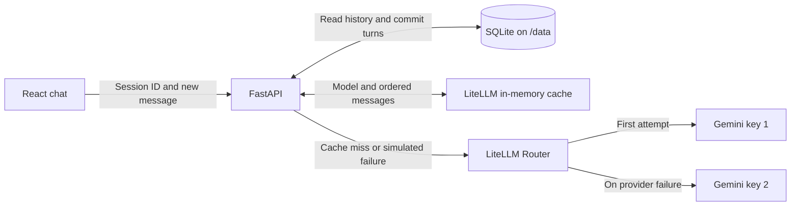

# Lyftr Chat

A multi-turn Gemini chat that keeps responding when an API key hits its quota. Each reply shows whether it came from Gemini or the cache, which model produced it, how long the request took, and how many tokens it used.

Built with React, FastAPI, LiteLLM, and SQLite for the Lyftr AI full-stack assignment.

## Live URLs

| Open | What to look for |
| --- | --- |
| [Chat app on Render](https://lyftr-chat-dc7y.onrender.com/) | Send a message and inspect the metadata below the reply. |
| [Backend on Railway](https://lyftr-chat-lyftr-chat1.up.railway.app) · [Health check](https://lyftr-chat-lyftr-chat1.up.railway.app/health) | The health response shows two configured keys and an enabled cache. |

1. **Try conversation context.** Send `Remember my project name is Atlas-742. Reply with its name.` Use a fresh name for each run. The first reply should show `LIVE_INFERENCE`. Ask `What name did I give you?` in the same chat.
2. **Try the cache.** Refresh to start a new session, then send the exact opening message with the same system prompt. Look for `LLM_CACHE`, matching text and token counts, and a lower latency.

The hosted backend runs one worker with a persistent volume at `/data`. Render builds the frontend with the Railway URL in `VITE_API_BASE_URL`. The backend permits the Render origin through `ALLOWED_ORIGINS`.

## Run locally: with Docker and without

### Docker Compose

Install Docker with Compose and Make. From the repository root, create your environment file if you don't already have one.

```sh
test -f .env || cp .env.example .env
```

Set `LLM_API_KEYS` in `.env` to two distinct Gemini keys separated by a comma. Both keys must have access to `LLM_MODEL`. Keep the keys in the backend environment. The default model is `gemini/gemini-3.5-flash-lite`.

```sh
make up
```

Open the [local chat](http://localhost:3000) and [backend health check](http://localhost:8000/health). Run `make down` to stop the stack. The named volume preserves the SQLite database.

### Without Docker

Install Python 3.12, uv, Node.js 22, and npm. Use the same `.env` setup. From the repository root, start the backend in one terminal.

```sh
set -a
. ./.env
set +a
cd backend
export DATABASE_URL=sqlite:///./data/app.db
uv sync --frozen
uv run uvicorn app.main:create_app --factory --port 8000
```

Start the frontend in a second terminal, also from the repository root.

```sh
cd frontend
npm ci
npm run dev
```

See [.env.example](.env.example) for the supported settings and defaults. For hosted Docker deployments, mount writable storage at `/data` and set `DATABASE_URL=sqlite:////data/app.db`. The backend listens on the hosting platform's `PORT` when provided.

## Design decisions: key fallback, caching, SQLite session storage



- **Ordered failover.** LiteLLM tries keys in configuration order with a bounded deadline. The API reports the serving alias, such as `key_2`, and the fallback count. If every key fails, the API returns a JSON `503`.
- **Cache identity.** The key combines the model with the ordered system prompt, history, and new message. Equivalent requests can share a cached reply across sessions. Hits preserve the original token counts and measure latency again.
- **Cache lifetime.** The in-memory cache expires entries after 10 minutes and clears on backend restart. Failure simulation bypasses cache lookup and storage so each simulated request exercises the router.
- **Durable conversation history.** FastAPI serializes turns within a session. It commits the user message, reply, metadata, and prompt update together after a successful completion. SQLite retains the full transcript across restarts.
- **Bounded model context.** By default, Gemini sees up to the latest 20 complete turns, the system prompt, and the new message. The browser sends only the session ID, new message, and any changed system prompt.

## Verification: how to see failover, cache hits and per-message token usage

### Run the live verifier

```sh
python3 scripts/verify_live.py https://lyftr-chat-lyftr-chat1.up.railway.app
```

The verifier exercises all three endpoints with a fresh prompt. It checks live inference, a cache hit in a separate session, token counts, both failover scenarios, history, and JSON errors. It prints the session ID for an independent history check.

### Inspect the API manually

```sh
API=https://lyftr-chat-lyftr-chat1.up.railway.app
SID="review-$(date +%s)"

curl -fsS "$API/health"

curl -fsS "$API/chat" -H 'Content-Type: application/json' \
  -H 'X-Simulate-Failure: key_1=429' \
  --data "{\"session_id\":\"$SID\",\"message\":\"Greet me in one sentence.\"}"

curl -fsS "$API/sessions/$SID/messages"
```

| Check | Expected result |
| --- | --- |
| Send the same first message in a fresh session | `LLM_CACHE`, matching reply and token counts, `key_id: null`, and faster latency. |
| Send `X-Simulate-Failure: key_1=429` or `key_1=500` | HTTP `200`, a Gemini reply, `key_id: "key_2"`, and `fallback_attempts: 1`. |
| Send `X-Simulate-Failure: *=429` | HTTP `503` with `{"detail":"all providers unavailable"}`. History stays unchanged. |
| Read the same session after a backend restart | The history endpoint returns the same message content and metadata. |

`ENABLE_FAILURE_SIMULATION=true` enables the header on the deployed backend. A simulated failure applies only to that request.

### Run the tests

| Suite | Command |
| --- | --- |
| Backend API, routing, and SQLite | In `backend/`, run `uv sync --frozen && uv run pytest -q`. |
| Frontend build and browser tests | In `frontend/`, run `npm ci && npm run build && npx playwright install chromium && npm test`. |
| Browser test against a running stack | In `frontend/`, run `STACK_URL=http://localhost:3000 npm test` after starting the configured stack. |

## Setup Used: your editor and AI tools

I used Codex desktop with Superpowers for planning, implementation, and review. I verified the public deployment with real Gemini calls, browser cache replay, and a SQLite history comparison before and after a Railway restart.

## Bonus features (if any): what you added beyond the requirements and why

- **Editable session prompt.** Reviewers can change the assistant's behavior for a conversation. Clearing the prompt restores the default on the next successful turn.
- **Retryable drafts.** A failed send restores the message to the composer so the user can retry or correct it.
- **Credential-free demo.** A separate Compose stack runs the app against a local Gemini-compatible test provider. It uses a dedicated database and deterministic responses for checking the integration without Gemini keys.

```sh
make demo
curl --connect-timeout 2 --retry 12 --retry-connrefused --retry-delay 1 -fsS \
  http://localhost:8100/health
python3 scripts/verify_live.py http://localhost:8100
```

Open the [local test chat](http://localhost:3100) or run `make demo-down` to stop the demo.
